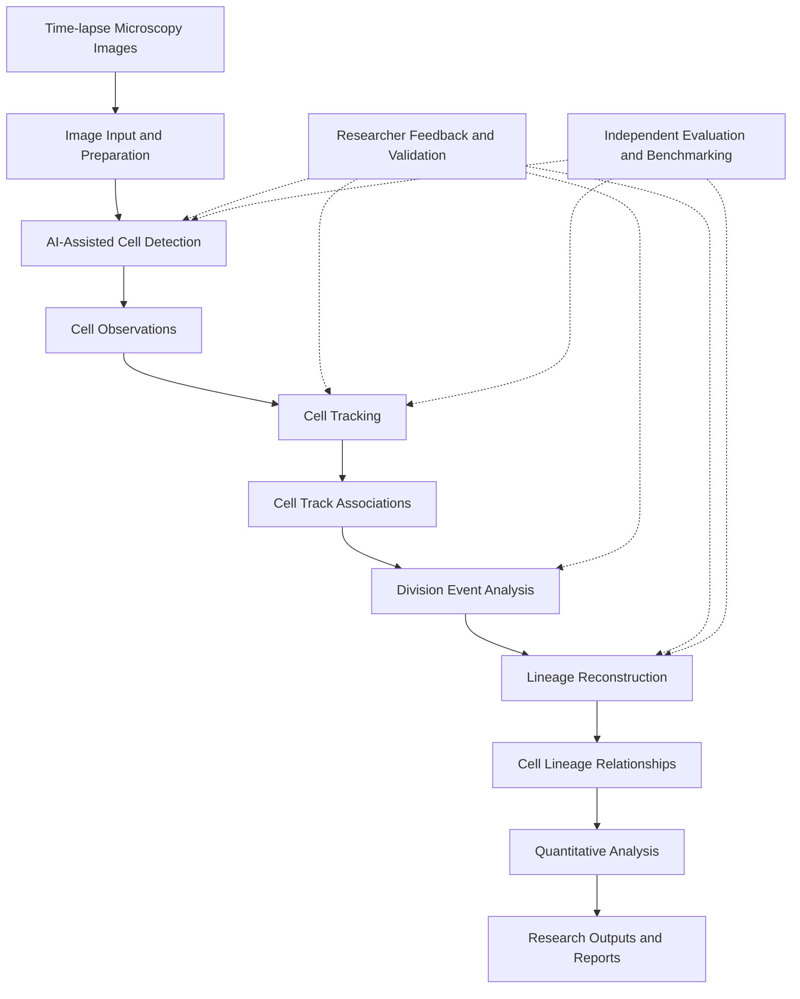

# LabOS — System Architecture

## 1. Overview

LabOS is designed as a modular workflow for analysing biological microscopy images, following cellular behaviour over time and reconstructing cell lineages.

## 2. Architecture Diagram

## 3. Main Components

| Component | Purpose |
|---|---|
| Image Input | Provides biological microscopy image sequences |
| Image Preparation | Prepares images for downstream analysis |
| Cell Detection | Identifies candidate cellular observations |
| Cell Tracking | Associates observations across consecutive frames |
| Division Analysis | Investigates cell division events |
| Lineage Reconstruction | Establishes parent–daughter relationships |
| Quantitative Analysis | Organises measurements and analysis results |
| Research Outputs | Presents results for further scientific investigation |

## 4. Development Status

The architecture represents the intended LabOS workflow, not a claim that every component is fully validated.

- **Core foundation:** image-analysis workflow, tracking and lineage-related functionality.
- **Experimental:** AI-assisted cell detection and its evaluation.
- **Ongoing development:** robustness, division analysis and scientific validation.
- **Future development:** a more complete researcher-oriented workspace and reporting experience.

## 5. Design Principle

LabOS follows a modular architecture so that individual components can be improved and evaluated independently while contributing to a unified biological image-analysis workflow.
