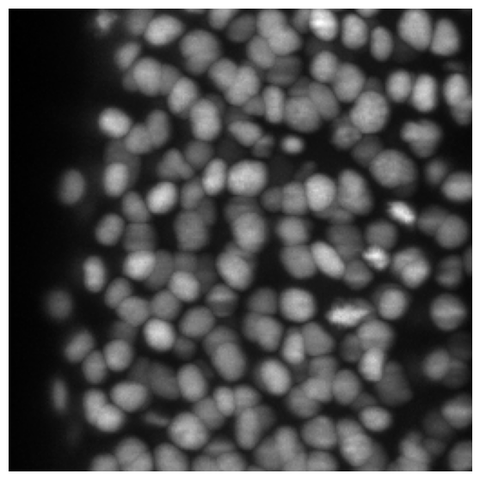
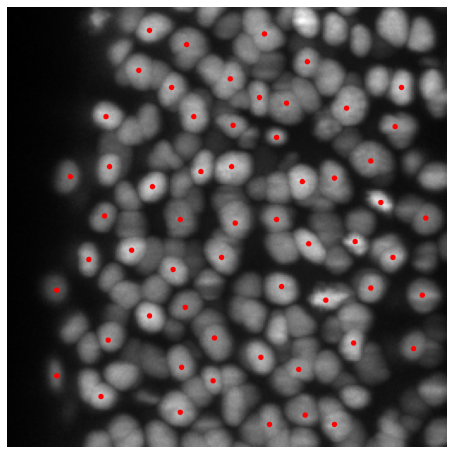
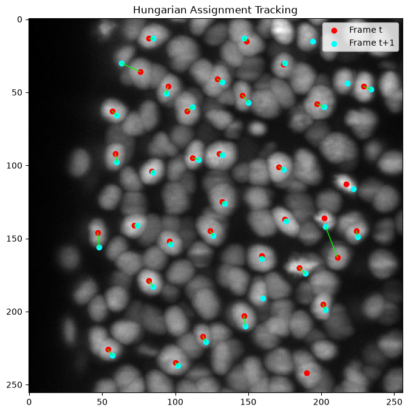

# LabOS – Visual Workflow Demonstration

This page illustrates the main stages of the LabOS microscopy analysis workflow.

## 1. Microscopy Input

The workflow starts with a microscopy image frame containing biological structures to be analysed.

## 2. Cell Detection

LabOS explores AI-assisted cell detection to identify candidate cell centres in microscopy images. This capability remains experimental and requires further validation.

## 3. Cell Tracking

The tracking module uses Hungarian assignment to associate detected cells across consecutive frames.

The coloured lines illustrate the associations between observations in two frames.

## Important Note

These images illustrate selected stages of the current research prototype. They do not establish validated performance across biological datasets or microscopy conditions.
